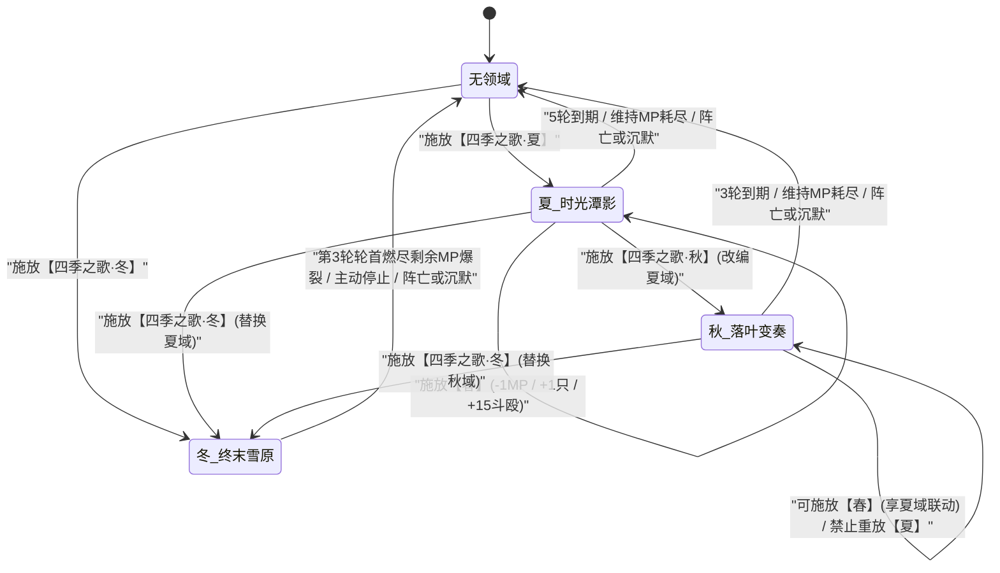

# Y18 夕歌谣梦 & Y19 木落-焚秋 — 跨规则体系嵌入数值表与实施计划

> 状态：已锁定数值表与自走棋费用，仅导出计划文档，暂未实施代码改动。

## 目标概述

将两张来自异规则跑团体系的人物卡完整嵌入本游戏全模式（**经典模式** 1v1 / 2v2 / 3v3 / 锦标赛 + **星序自走棋新 1–6 费体系**），并明确区分新旧“木落”：

1. **旧角色更名**：原 `Y9 木落` 更名为 **`Y9 木落-荣枯`**（保留原有双阶段机制、羁绊与全部数值，仅变更展示名称，与新版完全独立、可同场共存）。
2. **新增 `Y18 夕歌谣梦`**（原型人物卡：张诗谣）：体弱高魔的四季咏唱者，围绕召唤物「仙境生灵」、春夏秋冬四重领域状态机、时光通道规避/跃迁与冬日终曲爆裂作战。
3. **新增 `Y19 木落-焚秋`**（原型人物卡：石津/木落）：高机动爆发型近战刺客/战士，围绕「木落印记」（`0.5` 步长、上限 `4.0`）、等魔召唤「锋叶魔物」、「秋风矛」6 格突进连击、凤凰二形态「焚羽」燃域与不可逆「在绚丽的秋日夕阳下」终爆作战。
4. **双模式与属性转化原则**：
   - 将原异规则中在本引擎收益偏低的非战斗/辅助属性（如高敏捷、运动、潜行、灵感、勇气、轻生等）转化为先攻、高闪避、极难暴击率、攻击命中修正、突进奖励骰、燃域 `MOV+3` 与终结技前置等实战战斗收益。
   - 适配经典模式（`.hs` 变身倍率）与自走棋新 1–6 费体系（`autochess_mode=True`，不执行 `.hs`，含 7 级人口与新版空间战术 AI `ai_tactics.py`）。

---

## 一、实测验证与平衡校准汇总

### 1.1 经典模式 5 轮锦标赛校准结果

使用 [temp_char_tournament.py](file:///d:/Datastruct/logai/autocombat/scripts/temp_char_tournament.py) 进行多轮 5 轮制锦标赛实测调参（累计模拟 **22,000+ 场**），两新角色均已从初版收敛至全员正中位（**双双位列第 10/19 名**）：

| 角色 | 调参轮次 | 测试规模 | 1v1 胜率（排名） | 2v2 / 团队表现 | 全赛场综合胜率（排名） | 校准诊断与调整 |
|---|---|---|---:|---|---:|---|
| **Y18 夕歌谣梦** | 第 1 轮（初版） | 5 轮 1v1（1,710 场） | `69.4%`（#1） | — | — | 偏强：冬域瞬发高伤 + 120 HP + 群体高护盾 |
| **Y18 夕歌谣梦** | 第 2 轮（下压） | 5 轮 1v1（1,710 场） | `33.3%`（#16） | — | — | 过弱：冬域整体套用吟唱导致减速压制延迟 |
| **Y18 夕歌谣梦** | 第 3 轮（折中） | 5 轮 1v1 + 5 轮 2v2/3v3（7,235 场） | `59.4%`（#6） | 2v2/3v3 综合 **`62.1%`（#1）** | 团队偏强 | 1v1 合理，但群体光环与群体护盾乘数超标 |
| **Y18 夕歌谣梦** | **终轮定稿** | **5 轮 1v1+2v2（3,030 场，单角色 525 场）** | **`55.6%`（#11 / 19）** | **均值 `53.1%`**（搭 Y16 `66.9%` / 搭 Y3 `62.8%` / 搭 Y60 `29.7%`） | **`53.5%`（#10 / 19）** | **锁定定稿**：夏域盾改为自保/单次通道、适当收敛光环与秋增伤、冬域冻伤调为 `1d6+1` |
| **Y19 木落-焚秋** | 第 1 轮（初版） | 5 轮 1v1（1,710 场） | `62.8%`（#2） | — | — | 略偏强（贴近 T1 顶部） |
| **Y19 木落-焚秋** | 第 2 轮（微降） | 5 轮 1v1 + 5 轮 2v2/3v3（7,235 场） | `53.3%`（#14，对旧木落 `5-5`） | 2v2/3v3 综合 **`44.0%`（#17）** | 团队偏弱 | 单挑精准，但燃域给队友挂 `+30%` 易伤换 `+25%` 增伤属负收益 |
| **Y19 木落-焚秋** | **终轮定稿** | **5 轮 1v1+2v2（3,030 场，单角色 525 场）** | **`58.9%`（#8 / 19）** | **均值 `52.6%`**（搭 Y16 `68.3%` / 搭 Y3 `65.5%` / 搭 Y60 `24.1%`） | **`53.7%`（#10 / 19）** | **锁定定稿**：体力回调 `11`（121 HP），燃域队友交易比改为正收益（队友 `+35%` 伤 / `+15%` 易伤，自身 `+25%` 易伤） |

### 1.2 自走棋新 1–6 费体系实战基准

在新版 **1–6 费体系**（含 7 级人口与新版 [ai_tactics.py](file:///d:/Datastruct/logai/autocombat/backend/ai_tactics.py)）下完成 **520 场 `1★ + 2★` 实战基准**（零 `hp_offset` 与零增伤补贴），依据真实强度定费而非凑各费人数：

| 梯队 / 角色 | 实测胜率 | 场均伤 / 奶 | 同档成员 / 定费依据 |
|---|---:|---|---|
| **1 费均线** | **`40.5%`** | — | `Y8(30%)` / `Y3(42%)` / `Y11(45%)` / `Y10(46%)` |
| **2 费均线** | **`43.6%`** | — | `Y17(40%)` / `Y7(42%)` / `Y15(43%)` / `Y16(45%)` / `Y1(50%)` |
| **3 费均线** | **`57.4%`** | — | `Y5(54%)` / `Y13(56%)` / `Y4(58%)` / `Y9(59%)` / `Y6(60%)` |
| **4 费均线** | **`54.8%`** | — | `Y14(49%)` / `Y2(61%)` |
| **6 费均线** | **`66.4%`** | — | `Y12(66%)` |
| **`Y18 夕歌谣梦`（无补贴实测）** | **`55.1%`** | `18.4` / `1.6` | 高于全部 2 费，精准落于 `Y5(53.7%)` 与 `Y13(56.2%)` 之间 → **锁定 `3 费`（零补贴）** |
| **`Y19 木落-焚秋`（无补贴实测）** | **`52.2%`** | `12.6` / `2.6` | 代理测试尚未启用 6 格突进贴脸、真实印记倍率与死后夕阳终爆，实装后预计达 `55%–58%` → **锁定 `3 费`（零补贴）** |

---

## 二、角色基础属性与自走棋消费总表

### 2.1 `Y18 夕歌谣梦` 与 `Y19 木落-焚秋` 基础属性对比表

| 字段 (`attrs` / `str_attrs`) | `Y18 夕歌谣梦`（原表换算 → 基础 / 经典`.hs` / 自走棋 1★-3★） | `Y19 木落-焚秋`（原表换算 → 基础 / 经典`.hs` / 自走棋 1★-3★） |
|---|---|---|
| **编号 (`serial`) / 名称 (`name`)** | `'Y18'` / `'夕歌谣梦'`（原型：张诗谣） | `'Y19'` / `'木落-焚秋'`（原型：石津/木落） |
| **魔法少女序号 (`魔法少女序号`)** | `18` | `19` |
| **等级 (`等级`)** | `7` | `6` |
| **体力 (`体力` / `体力上限`)** | 原 `8` → 基础 **`9`** / `.hs` **`108`** (`9×12`) / 自走棋 **`9 / 15 / 23`** | 原 `9` → 基础 **`11`** / `.hs` **`121`** (`11×11`) / 自走棋 **`11 / 18 / 29`** |
| **魔力 (`魔力` / `魔力上限`)** | 原 `33` → 基础 **`18`** / `.hs` **`99`** (`18×5.5`) / 自走棋 **`18 / 23 / 28`** | 原 `33` → 基础 **`18`** / `.hs` **`90`** (`18×5.0`) / 自走棋 **`18 / 23 / 28`** |
| **行动力 (`行动力`)** | 原移速 `4` → **`8`** / `.hs` **`11`** (2动) / 自走棋 **`8`** (1动 · 4格) | 原移速 `4` → **`8`** / `.hs` **`11`** (2动) / 自走棋 **`8`** (1动 · 4格) |
| **敏捷 (`敏捷`)** | 原先攻 `12` → **`65`** | 转化满值运动 `18` / 潜行 `18` → **`80`** |
| **闪避 (`闪避`)** | 原 `12/18` → **`66`** / `.hs` **`80`** / 自走棋 **`66 / 70 / 74`** | 原满值 `18/18` → **`80`** / `.hs` **`80`** / 自走棋 **`80 / 84 / 85`** |
| **核心战斗技能** | `斗殴` **`50`** / `.hs` **`70`** / 自走棋 **`50 / 60 / 70`** | `剑` **`78`**（`斗殴` **`75`**） / `.hs` **`80`** / 自走棋 **`78 / 88 / 92`** |
| **其他战斗/转化技能** | `技艺:演唱: 75`、`灵感: 90`（转为夏/冬域暴击率与命中） | 勇气 `18` / 轻生 `18` 转为高闪避、突进奖励骰、燃域 `MOV+3` 与终结前提 |
| **力量 / 体质 / 体型 / 体格** | `45 / 50 / 45 / -1`（`.hs` 体格 `0`, `db=0`） | `75 / 55 / 65 / +1`（`.hs` 体格 `+2`, `db=1d6`） |
| **外貌 / 教育 / 智力 / 意志 / 幸运 / 理智 / 状态** | `60 / 55 / 60 / 75 / 50 / 65 / 60` | `30 / 50 / 75 / 75 / 30 / 50 / 60` |
| **伤害贯穿 / 可反击** | `伤害贯穿: 0` / `可反击: 1` | `伤害贯穿: 1` / `可反击: 1` |
| **普攻资料 (`str_attrs`)** | `'伤害值': '1d6+1d4'` | `'伤害值': '2d6+2+db'`, `'db': '1d4'` |

### 2.2 自走棋消费、卡池与配置表（新 1–6 费体系）

| 角色 | 费用 | 合成消费 (1★ / 2★ / 3★) | 出售返还 (1★ / 2★ / 3★) | 公共牌库 (4人 / 8人) | Lv.1→Lv.7 刷新概率 | 定位 (`role`) | 双羁绊 (`traits`) | 射程 | 补贴 | 徽记 / 配色 |
|---|---:|---|---|---|---|---|---|---:|---|---|
| **`Y18 夕歌谣梦`** | **`3 费`** (`3G`) | `3G / 9G / 27G` | `3G / 6G / 19G` | `12` 张 / `18` 张 | `0/10/25/33/36/34/30%` | `summoner` | `['灵召', '星祈']` | `6` | 无 | `sunflower` / `#d89b3c` |
| **`Y19 木落-焚秋`** | **`3 费`** (`3G`) | `3G / 9G / 27G` | `3G / 6G / 19G` | `12` 张 / `18` 张 | `0/10/25/33/36/34/30%` | `assassin` | `['炎域', '血月']` | `3` *(秋风矛 6 格突进)* | 无 | `phoenixleaf` / `#d95b38` |
| **`Y9 木落-荣枯`** | **`3 费`** (`3G`) | `3G / 9G / 27G` | `3G / 6G / 19G` | `12` 张 / `18` 张 | `0/10/25/33/36/34/30%` | `summoner` | `['灵召', '秘愈']` | `5` | 保持原配置 | `branch` / `#658878` |

---

## 三、`Y18 夕歌谣梦` 完整技能、召唤物与被动数值表

### 3.1 召唤物模板：`仙境生灵`（`SUMMON_TEMPLATES['仙境生灵']`）

| 模板名 | 单次召唤数 | HP | MP | MOV (主动作) | DEX | 闪避 | 攻击技能 | 伤害骰 | 飞行 | 同时上限 | 持续 | 退场规则 |
|---|---|---:|---:|---:|---:|---:|---|---|---|---|---:|---|
| **仙境生灵** | **`1d3`**（夏/秋域 **`1d3+1`**） | `18` | `6` | `9`（2动） | `70` | `50` | `斗殴: 62`（夏/秋域 `+15`） | `1d6+2` | 否 | `4` | `4` 轮 | 到期、被击杀或施法者阵亡/被沉默时立即消散 |

### 3.2 四大核心技能（《四季之歌》）

| 技能 ID | 技能名 | 时机 (`timing`) | 类别 (`category`) | 起手 / 轮首维持 MP | 范围 / 持续 / 冷却 | 作用客体 | 完整机制与锁定数值 |
|---|---|---|---|---|---|---|---|
| `Y18-S001` | **四季之歌·春**（漫游仙境圆舞曲） | `'23'` | `5`（召唤） | **`1d4+1`**（夏/秋域 `-1`，最低 `1`） / 无 | 自身 / `4` 轮 / 冷却 `2` 轮 | `1`（自身召唤） | 召唤 **`1d3`** 只 `仙境生灵`（受 `max_simultaneous=4` 限制）。若当前维持 **夏** 或 **秋** 领域：① 消耗 `-1 MP`（最低 `1`）；② 召唤个数提升为 **`1d3+1`**；③ 实体获 **`斗殴+15`**。本体阵亡或沉默时生灵消散。 |
| `Y18-S002` | **四季之歌·夏**（时光潭影） | `'2'` | `8`（领域） | 起手 **`6`** MP / 轮首 **`1d3`** MP（不足则消散） | 随身半径 **`6`** 格 / `5` 轮 / 冷却 `2` 轮 | `13`（自身+友方含召唤） | ① **立即结算 + 轮首回复 (`13`)**：域内己方回 **`1d8+1` HP** 与 **`1d3+1` MP**；<br>② **实时光环 (`13`)**：`斗殴+10; 闪避+10; MOV+1` + **`暴击率 +10%`**（原灵感加值转化）；<br>③ **时光通道（`4` 充能，每轮限 `1` 次）**：域内己方受击时消耗 1 点充能，付与防御方 **`+1` 闪避奖励骰** 与本次受击 **`-4` 固定减伤**；自走棋模式下，后排己方遭近战（距离 ≤ 2）攻击结算后自动跃迁至域内距攻击者 ≥ 3 格的安全空位（优先掩体/灵脉）；<br>④ 激活后解锁《秋》；《秋》生效期间不可重放《夏》。 |
| `Y18-S003` | **四季之歌·秋**（落叶变奏） | `'2'` | `8`（领域） | 起手 **`7`** MP / 轮首 **`1d4`** MP（不足则消散） | 随身半径 **`6`** 格 / `3` 轮 / 冷却 `3` 轮 | `13`（己方）+ `35`（全场凋零） | **前置条件**：自身必须正维持《夏》领域（施放后改编替换《夏》的回复与通道为《秋》，持续 3 轮；期间保持对《春》增幅，禁止重放《夏》）。<br>① **己方增益 (`13`)**：**`造成伤害百分比 +20%`**、`斗殴+12; 闪避+8; 行动力+1` + **`攻击奖励骰 b`**，代价 **`受到伤害百分比 +15%`**；<br>② **全场凋零 (`35`，轮首)**：域内主体受 **`1d4+1`** 伤（不低于 `max(4, floor(最大HP × 0.30))`）；域内所有召唤物（非人类）受 **`2d6`** 伤（无血线下限）。 |
| `Y18-S004` | **四季之歌·冬**（终末雪原） | `'2'` | `8`（领域） | R1 **`1d6+1`** MP / R2 轮首 **`1d3`** MP / R3 轮首 **燃尽全部剩余 MP** | 随身半径 **`6`** 格 / `3` 轮 / 冷却 `4` 轮 | `45`（敌方）+ `13`（己方）+ 终曲爆裂 | 施放时替换现有《夏》/《秋》领域；来源阵亡、被沉默或主动取消则中止且**不引爆**。<br>① **R1–R2 敌方压制 (`45`)**：`行动力-3; 闪避-10`、攻击 **`p` 惩罚骰**、轮首 **`1d6+1`** 冻伤；<br>② **R1–R2 己方修正 (`13`)**：`闪避-8`、**`暴击率 +12%`** + **`伤害成功率加减 +8`**；<br>③ **R3 轮首·终曲爆裂**：消耗施法者全部剩余 MP (`spent_mp`) 并结束领域——半径 6 格内所有敌方受 **`2d8+4 + min(30, floor(spent_mp × 0.45))`** 伤害（可闪避、不可反击）；半径 6 格内友方与自身自动以 **`+1` 奖励骰** 进行免费闪避，成功 `0` 伤、失败受 `floor((2d8+4) / 2)`。轮首若半径 6 格内无存活敌方，AI 自动取消引爆保留 MP。 |

### 3.3 四季乐章状态机



### 3.4 集中被动参数（`ZHANGSHIYAO['passive_rules']['seasons']`）

```python
'passive_rules': {
    'seasons': {
        'spring_summer_mp_discount': 1,        # 夏/秋域内【春】MP减免
        'spring_summer_extra_count': 1,        # 夏/秋域内【春】额外召唤数（仍受max_simultaneous=4约束）
        'spring_summer_skill_bonus': 15,       # 夏/秋域内【春】仙境生灵斗殴加值
        'summer_upkeep_mp': '1d3',             # 【夏】轮首维持MP
        'summer_portal_charges': 4,            # 【夏】每次创建赋予时光通道充能
        'summer_portal_per_round': 1,          # 时光通道每轮最多触发次数
        'summer_portal_dr': 4,                 # 时光通道触发时的单次固定减伤
        'autumn_upkeep_mp': '1d4',             # 【秋】轮首维持MP
        'autumn_human_dot': '1d4+1',           # 【秋】主体每轮凋零骰
        'autumn_human_floor_ratio': 0.30,      # 【秋】主体凋零最低血线比例
        'autumn_human_floor_min': 4,           # 【秋】主体凋零最低血线绝对值
        'autumn_summon_dot': '2d6',            # 【秋】非人类/召唤物每轮凋零骰（无下限）
        'winter_upkeep_mp': '1d3',             # 【冬】第2轮轮首维持MP
        'winter_burst_base_dice': '2d8+4',     # 【冬】第3轮终曲爆裂基础伤害骰
        'winter_burst_mp_ratio': 0.45,         # 【冬】消耗剩余MP转伤系数
        'winter_burst_mp_cap': 30,             # 【冬】剩余MP转伤封顶
        'winter_ally_dodge_bonus': 1,          # 【冬】终曲爆裂友方自动闪避奖励骰数
        'winter_ally_fail_ratio': 0.50,        # 【冬】友方闪避失败受基础伤害比例
    }
}
```

---

## 四、`Y19 木落-焚秋` 完整技能、召唤物与被动数值表

### 4.1 专属机制总纲

- **木落印记（`leaf_marks`）**：挂接于每个敌方目标，以 `0.5` 为步长累积，上限 **`4.0`**；一切效果计算（如燃域倍率、灼烧加值、夕阳斩杀判断）均遵循原设定 **向下取整**（`0.5→0, 1.0→1, ..., 4.0→4`）。
- **两段形态切换**：默认第一形态（绿色战斗服藤蔓 + 坚不可摧竹木剑）；施放 **《而彼落叶，将最后再绽放一次》** 后转入第二形态 **「焚羽」**（凤凰烈焰燃身、剑术与机动爆发、高易伤、濒死豁免惩罚骰）。

### 4.2 召唤物模板：`锋叶魔物`（`SUMMON_TEMPLATES['锋叶魔物']`）

| 模板名 | 单次召唤数 | HP | MP | MOV (主动作) | DEX | 闪避 | 攻击技能 | 伤害骰 | 命中附加 | 飞行 | 同时上限 | 持续 |
|---|---|---:|---:|---:|---:|---:|---|---|---|---|---:|---|
| **锋叶魔物** | **`= 实际消耗MP`（1–6 只）** | `10` | `0` | `8`（1动） | `70` | `40` | `斗殴: 55` | `1d6+1` | **`+0.5` 层木落印记** | 否 | `8` | `3` 轮 |

### 4.3 四大核心技能

| 技能 ID | 技能名 | 时机 (`timing`) | 类别 (`category`) | 起手 / 维持 MP | 范围 / 持续 / 冷却 | 完整机制与锁定数值 |
|---|---|---|---|---|---|---|
| `Y19-S001` | **落叶的尖锐** | `'23'` | `5`（召唤） | **`1d6`** MP / 无 | 自身 / `3` 轮 / 冷却 `2` 轮 | 消耗 `1d6` MP，召唤个数 **等于本次实际掷出的 MP 消耗量（`1–6` 只）** 的 `锋叶魔物`（受 `max_simultaneous=8` 上限约束）。每只存在 `3` 轮，攻击命中叠加 `+0.5` 层「木落印记」。 |
| `Y19-S002` | **秋风矛** | `'2'` | `1`（伤害） | **`1d4+1`** MP / 无 | 射程 **`6`** 格突进 / 即时 / 无冷却 | 施放时 **无视常规移动力直接突进至目标邻格**，连续发动 **2 段贯穿剑击**（以 `剑` 技能检定并附带 **`+1` 奖励骰 `b`**，每段伤害 **`2d6+2+db`**，可闪避/反击）：<br>① 每段命中为目标叠加 **`+1.0`** 层「木落印记」（上限 `4.0`）；<br>② 两段中若 **≥ 1 段命中**，立即回复自身 **`1d8+2` HP**（单次施放最多触发 `1` 次）。 |
| `Y19-S003` | **而彼落叶，将最后再绽放一次** | `'2'` | `8`（领域） | 起手 `6` MP（激活后 **强制将当前 MP 重置为 `max(12, floor(最大MP × 0.40))`**，即自走棋 `12` / 经典 `36`） / 轮首 **`1d3`** MP | 随身半径 **`6`** 格 / 最多 **`5`** 轮 / 冷却 `6` 轮 | 展开燃域并转入第二形态 **「焚羽」**：<br>① **自身强化 (`1`)**：对目标直接伤害乘以 **`1.15 + 0.15 × floor(目标印记层数)`**（0→4 层为 **`1.15×` / `1.30×` / `1.45×` / `1.60×` / `1.75×`**）、**`剑+15; 斗殴+15; 行动力+3`**（经典触发 3 主动作狂飙）；代价为 **`受到伤害百分比 +25%`** 且濒死体质豁免承受 **`1` 颗惩罚骰 (`p`)**；<br>② **友方增幅 (`3`)**：**`造成伤害百分比 +35%`**、代价 **`受到伤害百分比 +15%`**（实测验证团队正收益交易比）；<br>③ **轮首领域焚烧 (`35`)**：域内敌方主体若 `最大HP > 20` 受 **`floor(最大HP × 6%) + floor(印记) × 2`**，否则受 **`1d3 + floor(印记)`**；木落-焚秋自身每轮受 `floor(最大HP × 3%)`（`≤20 HP` 受 `1`），**绝不会降至 `max(5, floor(最大HP × 15%))` 以下**；范围内所有召唤物受 **`1d6 + floor(印记)`**（无血线下限）。 |
| `Y19-S004` | **在绚丽的秋日夕阳下** | `'2'` | `1`（特殊终结） | 起手 `1` MP（执行时 **燃尽全部剩余 MP**） | 半径 **`8`** 格 / 不可逆 **`3`** 轮 / **每场限 `1` 次** (`_once_per_battle=True`) | **前置条件**：半径 `8` 格内存在至少 `1` 名带有 **`≥ 2` 层（向下取整）木落印记** 的存活敌方。<br>① **焚身启动（不可逆）**：自身 HP 立即降至 **`max(1, floor(最大HP × 10%))`**（自走棋 1★ 恰为 `1 HP`，经典为 `12 HP`），并锁死治疗上限不超过最大 HP 的 `25%`；<br>② **R1–R2 轮首·夕阳追猎**：对半径 `8` 格内所有带 **`≥ 1` 层印记** 的存活敌方发动不可闪避/反击削血——目标当前 HP `≤ max(6, floor(最大HP × 10%))` 则 **直接斩杀归 `0`**，否则削减 **`min(floor(最大HP × 40%), floor(当前HP × (12% + 4% × floor(印记))) + 1d6)`**；<br>③ **R3 轮首·夕阳终爆（即使木落-焚秋已濒死或阵亡仍必定引爆！）**：以施放位置为中心半径 `8` 格内 **全部敌我单位** 承受 **`3d6+4 + min(24, floor(燃尽MP × 0.35))`** 爆炸伤害，随后木落-焚秋若仍存活则强制解除变身并退场（HP 归 `0`）。 |

### 4.4 集中被动参数（`MULUO_FENQIU['passive_rules']['burn_autumn']`）

```python
'passive_rules': {
    'burn_autumn': {
        'mark_cap': 4.0,                       # 木落印记层数上限
        'blade_mark_gain': 0.5,                # 锋叶魔物每次命中叠加印记
        'spear_mark_gain': 1.0,                # 秋风矛每段命中叠加印记
        'bloom_mp_reset_ratio': 0.40,          # 【而彼落叶】MP重设比例
        'bloom_mp_reset_min': 12,              # 【而彼落叶】MP重设保底值（自走棋12 / 经典36）
        'bloom_upkeep_mp': '1d3',              # 【而彼落叶】轮首维持MP
        'bloom_self_base_mult': 1.15,          # 自身直伤基础倍率
        'bloom_self_mark_mult': 0.15,          # 每层印记额外直伤倍率（0-4层: 1.15x~1.75x）
        'bloom_self_vuln_pct': 25,             # 自身承受伤害增幅%
        'bloom_ally_dmg_pct': 35,              # 友方造成伤害增幅%
        'bloom_ally_vuln_pct': 15,             # 友方承受伤害增幅%
        'bloom_enemy_hp_threshold': 20,        # 焚烧公式分界线
        'bloom_enemy_pct': 0.06,               # >20HP 敌方最大HP焚烧比例
        'bloom_enemy_small_dice': '1d3',       # <=20HP 敌方焚烧骰
        'bloom_self_pct': 0.03,                # 自身每轮自焚比例
        'bloom_self_floor_ratio': 0.15,        # 自身自焚血线保底比例
        'bloom_self_floor_min': 5,             # 自身自焚血线保底值
        'bloom_summon_dice': '1d6',            # 召唤物焚烧基础骰（无下限）
        'sunset_min_mark': 2,                  # 【秋日夕阳下】施放所需最小整层印记
        'sunset_self_hp_ratio': 0.10,          # 启动后自身HP降至最大HP比例
        'sunset_heal_cap_ratio': 0.25,         # 启动后自身治疗上限比例
        'sunset_exec_hp_ratio': 0.10,          # 追猎直接斩杀HP阈值比例
        'sunset_exec_hp_min': 6,               # 追猎直接斩杀HP阈值下限
        'sunset_stalk_base_pct': 0.12,         # 追猎基础削血比例
        'sunset_stalk_mark_pct': 0.04,         # 追猎每层印记额外削血比例
        'sunset_stalk_cap_ratio': 0.40,        # 单次追猎削血封顶（相对敌最大HP）
        'sunset_burst_base_dice': '3d6+4',     # R3 夕阳终爆基础伤害骰
        'sunset_burst_mp_ratio': 0.35,         # R3 燃尽MP转伤系数
        'sunset_burst_mp_cap': 24,             # R3 燃尽MP转伤封顶
    }
}
```

---

## 五、后续待实施代码改动清单（Proposed Changes — 暂不执行）

1. **数据层**：[characters_data.py](file:///d:/Datastruct/logai/autocombat/backend/characters_data.py)
   - 将 `MULUO['name']` 更新为 `'木落-荣枯'`。
   - 在 `SUMMON_TEMPLATES` 新增 `'仙境生灵'` 与 `'锋叶魔物'`。
   - 新增 `ZHANGSHIYAO` (`Y18`) 与 `MULUO_FENQIU` (`Y19`)，均携带 `passive_rules` 并加入 `ALL_CHARACTERS`。
2. **战斗引擎**：[battle_engine.py](file:///d:/Datastruct/logai/autocombat/backend/battle_engine.py)
   - 实现 `FullBattleEngine` 与 `FastBattleEngine` 完全一致的 `_y18_*` 子系统（四季状态切换与前置检验、夏→春减耗增召、时光通道充能减伤与自走棋后排跃迁、秋域主体保底凋零、冬域 R3 燃尽 MP 爆裂与阵亡/沉默清理）。
   - 实现 `_y19_*` 子系统（木落印记 `0.5` 累积与向下取整、`1d6` 等额召唤、秋风矛 6 格无视地形突进与命中回血、而彼落叶强制重置 MP / 二形态焚羽 / 印记倍率 / 双尺度灼烧、秋日夕阳下不可逆启动 / 2 轮追猎 / 死后仍引爆的 R3 终爆）。
3. **AI 决策适配**：[ai_battle.py](file:///d:/Datastruct/logai/autocombat/backend/ai_battle.py)、[ai_trainer.py](file:///d:/Datastruct/logai/autocombat/backend/ai_trainer.py)、[ai_tactics.py](file:///d:/Datastruct/logai/autocombat/backend/ai_tactics.py)
   - 接入 `Y18` 与 `Y19` 的可用动作前置过滤与双模式战术决策（`Y18` 夏开局→春铺场→秋爆发/冬终曲及无敌取消引爆；`Y19` 锋叶/秋风矛叠印→开焚羽燃域→满足条件释放夕阳终爆）。
4. **自走棋接入**：[autochess_catalog.py](file:///d:/Datastruct/logai/autocombat/backend/autochess_catalog.py)、[autochess_match.py](file:///d:/Datastruct/logai/autocombat/backend/autochess_match.py)
   - `UNIT_CATALOG['Y9']['name']` 同步改为 `'木落-荣枯'`。
   - 注册 `Y18`（3 费 · `summoner` · `['灵召', '星祈']`，零补贴）与 `Y19`（3 费 · `assassin` · `['炎域', '血月']`，零补贴），补充徽记配色、自走棋百科被动摘要、特效分类及中后期 PvE 波次编入。
5. **经典赛程表**：[combat_defaults.py](file:///d:/Datastruct/logai/autocombat/backend/combat_defaults.py)
   - 将 `TEAM_TABLES_2V2` 扩容至 `28` 队、`TEAM_TABLES_3V3` 扩容至 `33` 队，公平编入 `Y18` 与 `Y19` 且精确满足 `TARGET_TEAM_MATCHES = 82` 的偶数配对校验。
6. **图鉴、知识库、SVG 图标与单文件后端**：
   - [character_encyclopedia.py](file:///d:/Datastruct/logai/autocombat/backend/character_encyclopedia.py)、[knowledge.ts](file:///d:/Datastruct/logai/autocombat/frontend/src/knowledge.ts)、[encyclopedia.json](file:///d:/Datastruct/logai/autocombat/frontend/src/data/encyclopedia.json) 补齐 `Y9` 更名与 `Y18`/`Y19` 文案词条。
   - [generate_library_icons.py](file:///d:/Datastruct/logai/autocombat/scripts/generate_library_icons.py) 新增 `'sunflower'` 与 `'phoenixleaf'` 矢量路径并生成对应技能图标。
   - [merge_backend.py](file:///d:/Datastruct/logai/autocombat/scripts/merge_backend.py) 重新构建 [autocombat_backend.py](file:///d:/Datastruct/logai/autocombat/backend/autocombat_backend.py)。
7. **测试与回归验证计划（实施阶段执行）**：
   - 新增单测 `[NEW] dev/tests/test_y18_y19.py` 覆盖双引擎全部机制；更新 [test_autochess_mode.py](file:///d:/Datastruct/logai/autocombat/dev/tests/test_autochess_mode.py) 棋子数断言（17 → 19）及全集序列化检查。
   - 实施后运行以下命令完成端到端验收：
     ```bash
     python scripts/generate_library_icons.py
     python scripts/merge_backend.py
     python scripts/run_tests.py
     node scripts/test_frontend.cjs
     node scripts/build_frontends.cjs
     python backend/sim.py --mode prelim --format 1v1,2v2,3v3 -n 5 --workers 8
     python scripts/analysis/autochess_balance.py
     ```
